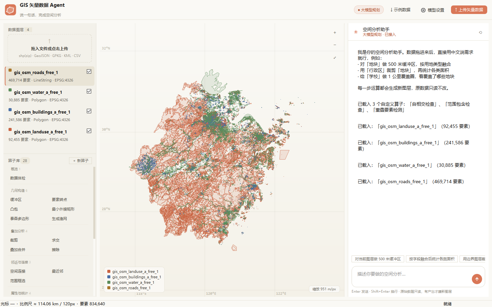

# GIS 矢量数据 Agent

一句话操作矢量数据：拖进 Shapefile / GeoJSON，用中文说需求，Agent 规划算子链、真实执行空间运算、生成新图层，并在内置地图上直接看结果。

界面是**纯 Qt 原生控件**（PySide6 + QWidget + QPainter），没有任何 WebView / 浏览器内核，进程里不会出现 `msedgewebview2.exe`。



## 快速开始

**双击 `启动.bat`** —— 直接打开原生 Windows 窗口，关掉窗口即退出。

```bash
python -m venv .venv
.venv\Scripts\python.exe -m pip install -r requirements.txt

.venv\Scripts\python.exe native_app.py   # 原生 Qt 界面（等同双击 启动.bat）
```

启动异常时双击 `调试启动.bat`（带控制台）；数据载入、运算的日志在 `data\app.log`。

首次打开点右上角 **示例数据**，会生成成都某片区的 4 个图层（行政区 / 地块 665 / 道路 / 学校），可直接演示。

## 它到底能做什么

对着输入框说人话即可，例如：

| 你说 | Agent 执行的算子链 |
| --- | --- |
| 对地块做 500 米缓冲区，然后按用地类型统计面积 | `buffer` → `area_stats`（第二步自动接上第一步的结果） |
| 用行政区裁剪道路，再统计各类面积 | `clip` → `area_stats` |
| 给学校生成泰森多边形 | `voronoi` |
| 在地块范围生成 1 公里渔网 | `grid` |
| 筛选地块中容积率 > 3 的要素 | `filter` |
| 为学校查找最近的道路 | `nearest` |
| 把学校的属性空间连接到地块 | `sjoin` |
| 检查地块的数据质量 | `describe` |
| 导出地块为 shapefile | 存成 zip |

**25 个内置算子**（按用途分组，与界面左栏一致）：

| 组 | 算子 |
|---|---|
| 概览 | 数据体检 |
| 几何构造 | 缓冲区、要素转点、凸包、最小外接矩形、泰森多边形、生成渔网 |
| 叠加分析 | 裁剪、求交、叠加合并、擦除 |
| 邻近与连接 | 空间连接、最近邻、范围框选 |
| 属性与统计 | 属性筛选、字段计算、面积/长度统计、形状指标 |
| 整理 | 融合、图层合并、去重、几何简化、投影转换、几何修复、拆分多部件 |

### 自定义算子（按文字描述生成）

算子库里点「＋ 新算子」，用一段中文描述算法（例如「统计每个地块面内道路的总长度和条数」），
大模型会写一个 `def op(gdf, args)` 函数：先弹预览给你看代码和试跑结果，确认后才入库。

- **契约**：`op(gdf, args) -> (GeoDataFrame 或 None, 说明)`；可用 `pd / np / gpd / shapely`
  以及 `metric(gdf)`（转米制）、`to_wgs(gdf, like)`（转回原坐标系）。参数名写 `other` / `mask` 时，
  引擎会自动把它换成另一个图层的 GeoDataFrame —— 所以「每个面内道路总长」这类跨图层算法也能写。
- **沙箱**：AST 静态检查，禁止 `import`、`while`、文件/网络/系统调用、`__` 属性；运行时只注入白名单内建函数。
- **持久化**：源码存 `data/operators/<name>.json`，下次启动自动装回；算子库按钮、大模型提示词、
  规则引擎三处同步可见，和内置算子完全同权。

每一步以一行式工具调用回显：状态点 + 算子名 + 耗时，细节缩进在下面（要素数变化、告警、统计小表、"新图层"标记、定位 / 属性表 / 导出）。

## 界面说明

视觉参照 **Claude Code 桌面端**：近乎单色（暖白纸底 #faf9f5 + 近黑文字），全界面只有一个强调色（陶土橙 #d97757），
靠 1px 暖灰细线分隔、不用大圆角卡片和阴影；助手回复是纯文本段落（不套气泡），用户消息是一块浅色底块。

- **左栏**：暖灰底，拖入即载入；图层列表带显隐勾选，**双击图层名可直接改名**，
  右键菜单：缩放到图层 / 属性表 / 重命名 / 复制图层 / 只显示此层 / 显示全部 / 导出（4 种格式）/ 删除；
  重命名会自动避开重名（加序号），也能 `Ctrl+Z` 撤回。下方算子库**按用途分 6 组**排布——
  概览 / 几何构造 / 叠加分析 / 邻近与连接 / 属性与统计 / 整理（自建算子另起「我的算子」组），
  组标题带组内算子数、组间以发丝线分隔，组内两列并排；点一下就把该算子的指令模板写进输入框，悬停看算子说明。
- **中间**：QPainter 自绘地图，支持拖拽平移、滚轮缩放（以光标为中心）、双击放大、悬停高亮、点击看属性、经纬网与比例尺。
  **Shift + 拖拽 = 框选**（只作用于左栏当前图层）：选中的要素描朱红边 + 淡填充，状态栏实时报数量，
  这时在右栏说一句「做 500 米缓冲区」，会**先把选中要素单独成一层**再执行——算子从此能作用于"一部分"而不是整层。
  Esc 先清选区、再清高亮；点空白处也取消选择。
  **键盘**：`←→↑↓` 平移（按住 Shift 步长 ×4）、`+`/`-` 缩放、`Home` 全图；**中键拖拽**也能平移（GIS 老习惯）。
  **右键菜单**：全图 / 缩放到当前图层 / 把选中要素存成图层 / 清除选区 / 导出当前视图 / 导出当前图层。
- **属性表 ↔ 地图联动**：点表格任意一行，地图立刻高亮该要素并缩放到它；表头点击排序（再点反向），
  顶部筛选框对任意列做包含匹配，超过 200 行进分页——不再截断成"只能看前 500 行"。
- **右栏**：白底对话区；底部是一个整体式的圆角输入容器（圆形箭头发送），Enter 发送 / Shift+Enter 换行，
  **`↑`/`↓` 翻之前发过的指令**（单行时接管，多行不会抢光标），Ctrl+O 打开文件，Ctrl+0 全图。
- **导出视图**：`Ctrl+Shift+S`（或地图右键）把当前画面存成 PNG —— 连图例和缩放键一起抓，出报告直接用。
- **可撤销**：`Ctrl+Z` / `Ctrl+Shift+Z`（或 `Ctrl+Y`）。因为算子只产出新图层，撤销 = 把派生层摘掉/放回，
  包括「删掉的图层按原位置还原」，栈深 20 步。
- **载入有进度**：状态栏右侧一根细进度条 + 「取消」，按「文件 i/n」推进；取消后**当前文件读完就停**，
  已经载完的图层保留。

**图标**：陶土橙圆角底 + 一个面要素轮廓（带三个顶点句柄），第二层淡轮廓暗示图层叠置。
同一套绘制代码三种用法——运行时 `make_icon()` 现画多尺寸 QIcon（16/24/32/48/64/128/256）、
`native/assets/icon.png`（256）、`native/assets/icon.ico`（多尺寸，做桌面快捷方式用）。
小尺寸会自动减笔画：16/20 px 只留实心面，24~40 留轮廓 + 句柄，更大才画后层。
重新生成：`python tools/make_icon_assets.py`。

## 规划引擎：两级

1. **规则引擎（默认，离线可用）**
   内置中文指令解析器：图层名模糊匹配、单位与数字抽取、多条指令按"然后 / 再 / ；"拆句，并把上一步的输出自动串给下一步（流水线）。
2. **大模型规划（可选）**
   「模型设置」里填任意 OpenAI 兼容接口（DeepSeek / 通义千问 / OpenAI / 本地 Ollama），Agent 会把图层清单、字段、算子签名一起发给模型，拿回结构化 JSON 计划再执行。接口超时或返回不合法时**自动回退**规则引擎（连续失败会静默 2 分钟，避免每条指令都卡住）。
   Key 只存在本机 `data/settings.json`。

## 生产规范（不是 demo 级别的糊弄）

- **原始数据只读**：任何算子都不修改入参图层；**真有产出**时才新建图层，父子关系记在图层元数据里。
  检查类算子（数据体检）只出报告；「几何修复 / 去重」发现零变化时不建层，避免图层面板凭空多出一个几乎同名的副本。
  下一步用 `$prev` 引用上一步结果时，若上一步没建层就沿用它自己的输入图层，链条不断。
- **CRS 强制校验**：距离 / 面积运算前自动投影到 **CGCS2000 3 度带**（按数据中心经度选带，EPSG:4534–4554）；境外退回 UTM；跨带会提示投影变形。
- **几何有效性**：入口处 `make_valid` 修复无效几何并计数（超过 5 万要素的图层跳过逐个校验，避免卡死）。
- **空值安全**：真实数据里成片的 NULL 会在 JSON 序列化时炸掉接口（`NaN is not JSON compliant`），Web 版统一走 `json_safe` 清洗；导出 GeoJSON 前也会把 NaN 变 null。
- **Shapefile 编码**：读入时在 UTF-8 / GBK 间择优（中文不乱码）；导出时字段名按 **10 字节**安全截断，超限改名 `F1/F2…` 并在压缩包里附 `字段对照.txt`——否则中文会被切成半个字，DBF 直接读不回来。
- **离线性**：地图是自绘渲染器，不依赖在线瓦片、不依赖 CDN。
- **选区即输入**：框选的要素会被复制成一个独立图层（`原层名_选中N`）再参与运算，不污染原图层；
  这一层同样可以撤销 / 导出 / 删掉。

## 渲染管线（对照 QGIS 源码实现）

地图完全用 QPainter 自绘（Web Mercator）。渲染管线逐项对照 QGIS 的源码结构实现，
用到的参照类：

| 本项目 | QGIS 对应 | 说明 |
| --- | --- | --- |
| `_RenderJob` | `QgsMapRendererJob` | 一次渲染任务的上下文 + 世代号（epoch） |
| `_RenderWorker` | `QgsMapRendererParallelJob` | 常驻渲染线程，请求队列只留最新一个 |
| `_LayerJob` | `LayerRenderJob` | **每个图层渲染到自己的一张 QImage** |
| `_compose()` | `composeImage()` | 在**干净画布**上按顺序把各层叠成整帧 |
| `_img_cache` | `QgsMapRendererCache` | 图层级缓存：键 = 视口 + 尺寸 + dpr + 图层几何版本 |
| `_RenderSet` | 渲染范围 + `QgsSimplifyMethod` 的组合 | 一个「范围 + 容差」下的一整套路径 |
| `_select_indices()` | `QgsFeatureRequest::setFilterRect(extent)` | 视口矩形筛要素，**筛完全量画** |
| `_simplify_tol()` | `QgsSimplifyMethod::tolerance` | 容差以**屏幕像素**为准（0.8 px 对应地面距离） |
| `_split_subpixel()` | `QgsSimplifyMethod::threshold` | 屏幕尺寸 < 1.5 px 的面要素降为点绘制 |
| `_keep_mask()` | 简化器的退化保护 | 小要素被简化没了就回退原几何 |

关键机制：

- **要素选取不抽样（重要）**：范围里相交的要素**一个不少**全部进渲染集。
  任何抽样/配额/预算压制都会在屏幕上变成一块一块的空洞 —— 因为渲染集一旦被
  当成「这个范围已经画好了」缓存下来，缺的要素就再也不会被补上。
  渲染集的完备性是复用判据（`rect` 覆盖当前视口）成立的前提。
- **不做覆盖范围记账**：每套渲染集只记录自己那个矩形。判据是
  「**某一个**集合完整包含视口」，不是「若干集合的并集包含视口」——
  后者在平移出几段不相邻区域后会把中间的空白也当成已覆盖，正是矩形空洞的来源。
- **合成绝不叠旧帧**：每帧在干净画布上从零合成，整帧画完才替换上屏
  （`QgsMapRendererParallelJob` 结束时换图的语义）。在上一帧上继续叠图层会让
  14% 的填充叠成实色，看起来就像「有些地方渲染错了」。
- **世代号（epoch）**：视图一变就 +1，旧世代的帧和图层图一律丢弃，旧帧不会覆盖新帧。
- **取消不阻塞**：对应 QGIS 的 `feedback()->cancel()`，旧任务在图层间隙收工；
  但**不取消正在跑的任务**，否则连续缩放时每帧都半途而废、屏幕一直停在旧画面。
- **按图层渲染 + 合成**：每层只遍历一遍自己的要素包围盒，一层画完就能先合成。
- **图层缓存**：同视口下切显隐、调图层顺序直接复用上次的图层图。
  缓存键用**图层自己的**几何版本号，别的图层重建不会把这张图废掉。
- **屏幕像素级容差**：0.8 像素对应的地面距离，放大后自动变细；
  小要素靠逐要素退化检测（空 / 面积缩水 >60%）回退原形。
- **亚像素要素画成点**：省域视图下 24 万栋建筑总共只剩 4 个顶点，
  按容差简化等于让它们凭空消失。改成画 1 个设备像素的点：
  既不丢要素，也省掉海量无用顶点（用 `drawPoints` 的 hairline 笔——
  笔宽 > 1 时 Qt 会按端帽把退化的点画成横条，8 万个点能糊成一整片实色）。
- **路径按批合并**：Qt 每次 `drawPath` 的固定开销远大于顶点开销，
  逐要素画 47 万条道路要 800 ms，按 256 个要素一批合并后只要 190 ms。
- **线宽按比例尺分档（这条最省钱）**：`1.6px` 圆头笔会走 Qt 的**完整抗锯齿描边器**
  （每个顶点生成四边形 + 端帽 + 拐角连接），而**整数宽度 1** 有一条快速路径。
  实测 47 万条道路 / 94 万顶点，省域视图 1.6px 要 1914 ms，1.0px 只要 79 ms（24 倍），
  落笔像素数几乎一样（11.9 万 vs 11.0 万）。所以「每像素地面米数 ≥ 45（约 1:17 万）」
  一律画 1px —— 这个比例尺上 6 米宽的路本来就不足 0.01 像素，1px 才是正确画法。
- **每个环/部件的包围盒用 numpy 一次算完**：原来是逐个 part 对切片做 4 次 min/max，
  47 万个 part 就是近 200 万次 Python 切片归约；改成 `np.minimum.reduceat` 按 part 起点归约。
- **分片几何构建**：每片 10 ms 预算，构建期间界面照常响应；载入数据期间
  自动暂停构建，避免和解析线程抢 GIL（实测 4 个大图层抢着跑要 50 s，串行 23 s）。

**效果（4 个图层 83.5 万要素，地图视口 715×805）**

| 场景 | 优化前 | 现在 |
| --- | --- | --- |
| 省域视图重绘（渲染集已就绪，纯绘制） | 3.64 s | **0.35 s** |
| 缩到 1:1M（重建渲染集） | 1.62 s | **1.00 s** |
| 缩到 30 m/px（重建渲染集） | 0.31 s | 0.31 s |
| 平移 120 px（渲染集复用） | 0.09 s | 0.10 s |
| 缩回省域 | 1.93 s | **0.27 s** |
| 载入 + 首次出图 | 23.0 s | 20.0 s |
| 同视口清空重建 vs 缓存画面 | 像素差异 **0.005%~0.03%** | 0.0245%（251 / 1,024,000 px） |

放大那两级剩下的时间主要在**几何构建**（把 47 万条道路的坐标写成 QPainterPath 的顶点调用）
和**简化**上，属于每个比例尺只付一次的代价，不是每帧成本。

### 为什么没有上 OpenGL

`tools/perf_backend.py` 在真 GL 上下文（4.6）+ 离屏 FBO 里画**同一份渲染集**，逐图层对比
（每一项都统计落笔像素，防止「路径被挪到画布外、只量到裁剪时间」的假结果）：

| 图层（省域视图 951 m/px） | 几何 | CPU 光栅 | OpenGL |
| --- | --- | --- | --- |
| 用地 landuse | 28 条面批 | **106 ms** | 921 ms（慢 8.7 倍） |
| 建筑 buildings | 24 万个点（`drawPoints`） | **16 ms** | 1963 ms（慢 124 倍） |
| 水系 water | 20 条面批 | **45 ms** | 323 ms（慢 7.1 倍） |
| 道路 roads | 1958 条线批 | 79 ms | **38 ms（快 2 倍）** |

结论：GL 只在**线描边**上占便宜，遇到「大量小面 / 大量点」反而慢一个数量级 ——
QPainter 在 GL 上要把路径三角化（stencil-and-cover），而 CPU 光栅对大量小图元有更直接的路径。
整帧实测 4 层一起画：CPU 350 ms vs GL 5975 ms，所以渲染后端保持 CPU 光栅，
性能花在「1px 笔宽 + 包围盒向量化」上（上面那两行表格就是收益）。
脚本留着：换机器、换驱动、或者以后要画「粗线条风格」时，先跑它再决定要不要搬。

`tools/verify_render.py` 就是这套验证脚本：真实数据 + 离屏渲染，跑
「省域 → 逐级放大 → 平移 → 缩回」，最后清空渲染集重建同一视口逐像素比对 ——
如果渲染集的范围/要素有偷工减料，两次画面就会不一样，差异区域正好就是
屏幕上那些「没渲染出来的块」。截图见 `docs/perf/verify-*.png`。

> 已知边界：`geopandas.read_file` 在后台线程里会较长时间持有 GIL，
> 载入超大 Shapefile 时主线程仍会被拖住。已通过「串行载入 + 载入期间暂停构建 +
> 读 `.cpg` 编码一次读对（不再三遍择优）」把影响降到最低。


## 支持的格式

读：`.zip`（可含多个 shp，弹窗勾选要载入哪些）、`.shp`、`.geojson/.json`、`.gpkg`、`.kml`、`.gml`、`.csv`（经纬度列或 WKT 列）
写：GeoJSON、GeoPackage、Shapefile（zip）、CSV（含 WKT）

## 目录结构

```
gis-agent/
├─ 启动.bat               # 双击即用：打开原生窗口（pythonw，无控制台）
├─ 调试启动.bat           # 带控制台启动，排查问题用
├─ native_app.py          # 桌面入口（QApplication + 主窗口）
├─ native/                # 纯 Qt 界面层
│  ├─ app.py              # 主窗口：三栏布局、图层、动作、对话编排
│  ├─ mapview.py          # 地图控件：QPainter 自绘 / 分块渲染 / 比例尺分级 / 拾取
│  ├─ chat.py             # 对话面板：气泡、步骤卡片、后台线程
│  ├─ dialogs.py          # 属性表 / 模型设置 / 多图层选择
│  ├─ theme.py            # 浅色主题样式表
│  └─ format.py           # 数值与字段名格式化
├─ app/                   # 与界面无关的内核
│  ├─ engine.py           # 图层仓库 + 25 个算子的真实实现（GeoPandas/Shapely/PyProj）
│  ├─ agent.py            # 两级规划器（规则 / 大模型）+ 计划执行器 + 算子签名
│  ├─ io_utils.py         # 矢量读写、压缩包解压、导出（编码/字段名/空值都在这处理）
│  ├─ config.py           # 大模型配置读写
│  ├─ util.py             # JSON 安全化（NaN/Inf/numpy/时间）
│  ├─ samples.py          # 示例数据生成器
│  └─ main.py             # （可选）FastAPI 服务，给网页版用
├─ web/ + desktop.py + run.py   # 网页版界面（旧方案，仍可用）
├─ samples/               # 生成后的示例 GeoJSON
└─ data/                  # 上传缓存 + settings.json + app.log
```

## 扩展一个新算子

1. 在 `app/engine.py` 写 `def _my_op(store, layer, ...) -> Result`，返回 `Result(ok, message, new_layer, warnings, data)`；
2. 注册到 `OPERATIONS`；
3. 在 `app/agent.py` 的 `TOOL_SPECS` / `TOOL_LABEL` 加签名与中文名（大模型、算子库按钮都会自动读到）；
4. 若要支持固定说法，在 `_parse_clause` 里加一条正则分支。

## 已知边界

- 单机单会话，图层存内存，关掉窗口后需重新载入（已导出的文件不受影响）。
- 单图层绘制上限 6 万要素（超出按等距抽样显示，点击拾取仍走全量空间索引）；24 万要素的图层实测首次绘制约 0.2 s、缩放重绘 0.13 s。
- 底图是经纬网，不含在线瓦片；要接底图可自行往 `MapView.paintEvent` 里插瓦片图层。
- 规则引擎覆盖常见中文表达，长句、口语化、多目标推理建议接大模型。
- 网页版（`run.py` + `web/`）仍保留，接口与算子完全共用，只是界面不同。
